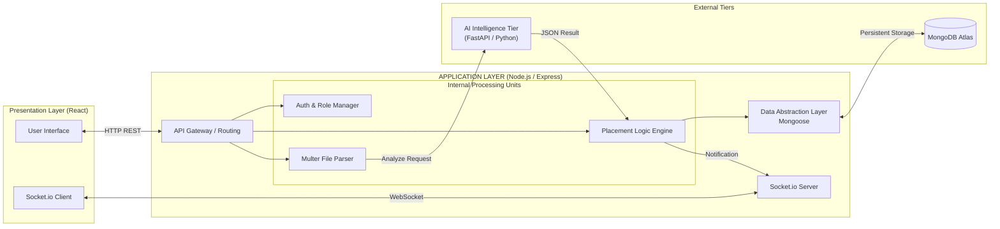

# System Architecture: Application Layer Block Diagram

This document provides a **Block Diagram** representation of the Application Layer to illustrate its internal components and how they coordinate the system's workflow.

---

## 1. Application Layer Working Block Diagram

The block diagram below shows the high-level structural organization of the Application Layer (Node.js/Express) and its horizontal communication channels.

---

## 2. Explanation of Working Blocks

In the context of System Architecture, the Application Layer is the **Brain** that manages the flow of information between the user and the raw data/intelligence tiers.

### 1. API Gateway / Routing
*   **Definition**: The entry point for all frontend communication.
*   **Working**: It intercepts every incoming HTTP request (e.g., job application, login, resume upload) and directs it to the specific processing unit required. It ensures that traffic is handled efficiently and directed to the correct controller.

### 2. Internal Processing Units (Controllers)
*   **Auth & Role Manager**: Validates the **JWT** tokens. It ensures that a Student cannot access Recruiter data and that every action is mathematically verified for security.
*   **Placement Logic Engine**: The core "Working" unit. It manages the business rules—such as tracking which jobs a student has applied for and synchronizing results from the AI engine into the user's profile.
*   **Multer File Parser**: A specialized unit for handling "Heavy" data. It streams PDF and Docx files from the user to the server and prepares them for the AI Engine.

### 3. Socket.io Server (Real-Time Block)
*   **Definition**: The bi-directional communication channel.
*   **Working**: Unlike standard HTTP which is one-way, this block stays "Open." Its primary work in this architecture is to push immediate notifications to the user (e.g., *"Your Resume Analysis is Complete!"*) the millisecond the AI finishes its work.

### 4. Data Abstraction Layer (Mongoose)
*   **Definition**: The translator between logic and storage.
*   **Working**: It ensures that the complex data produced by the AI (JSON snippets, PRS scores) is converted into a standard format before being written into the **MongoDB** database. It protects data integrity and handles queries.

### 5. Intelligence Bridge (Outbound Connection)
*   **Definition**: The connector to the Python AI service.
*   **Working**: It facilitates the **Communication Architecture**. It takes the raw output of the file parser, sends it to the AI tier, and retrieves the "Intelligence" (scores and gaps) to be fed back into the Business Logic block.
