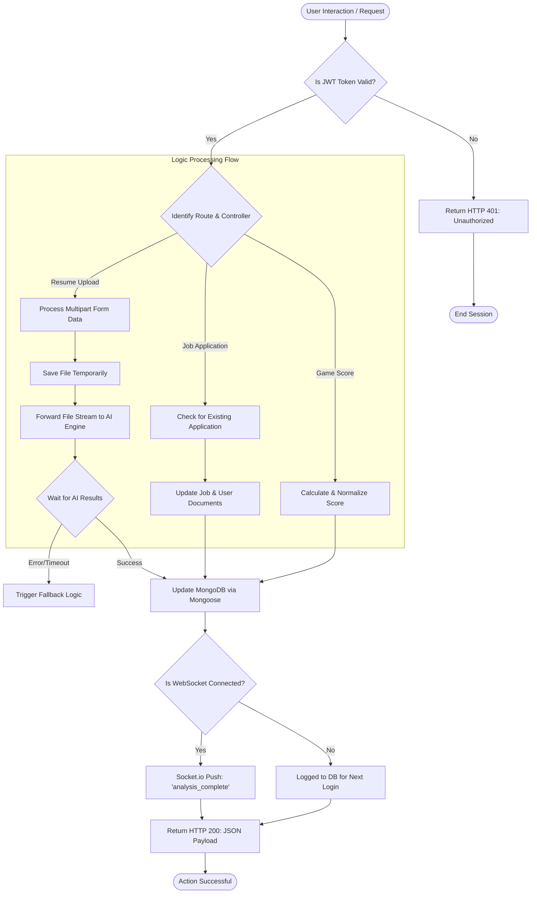

# System Architecture: Application Layer Flowchart

This document illustrates the **logic flow** and decision-making process within the Application Layer (Node.js/Express) during a standard user interaction.

---

## 1. Application Layer Flowchart

The following flowchart details the step-by-step logic path taken by the system when a request enters the application layer.

---

## 2. Explanation of Logic Flow

In a System Architecture, the **Flowchart** explains the *order of operations* and how the system handles different scenarios.

### 1. The Security Gate (Auth Logic)
Before any business logic runs, the application layer checks the **Identity**. 
*   **Logic**: Every request must carry a valid JWT (JSON Web Token). If the token is missing or expired, the flow is immediately terminated at the "Gate" to protect system resources.

### 2. Multi-Path Routing
The Application Layer uses different logic paths depending on the request type:
*   **Intelligence Path (Resumes)**: This path involves external service coordination. If the AI Engine is slow or errors out, the flowchart shows a "Fallback" loop where the system might retry or notify the user of a delay.
*   **Transactional Path (Jobs)**: This path focuses on database consistency, ensuring that a student doesn't apply for the same job twice.

### 3. Asynchronous Coordination (AI Wait)
The flowchart highlights a critical architecture decision: **Asynchronous Processing**.
*   **Working**: Because AI analysis (parsing/matching) takes time, the application layer doesn't "lock" the entire system. It enters a waiting state for that specific request while keeping other user flows active.

### 4. Persistence & Real-Time Sync
Once processing is complete, the flow converges on the **Database Update**:
*   **Logic**: The system updates the `User` and `Profile` models simultaneously.
*   **Real-Time Fork**: The flowchart shows a decision point based on the **Socket.io connection state**. If the user is online, they get an instant push; if they are offline (e.g., they closed the tab), the data is simply saved for their next visit.

### 5. Final Payload Delivery
The flow ends by returning a structured **HTTP 200 JSON Response** to the React frontend, which then triggers the UX transition (e.g., changing the button state from "Analyzing" to "View Report").
