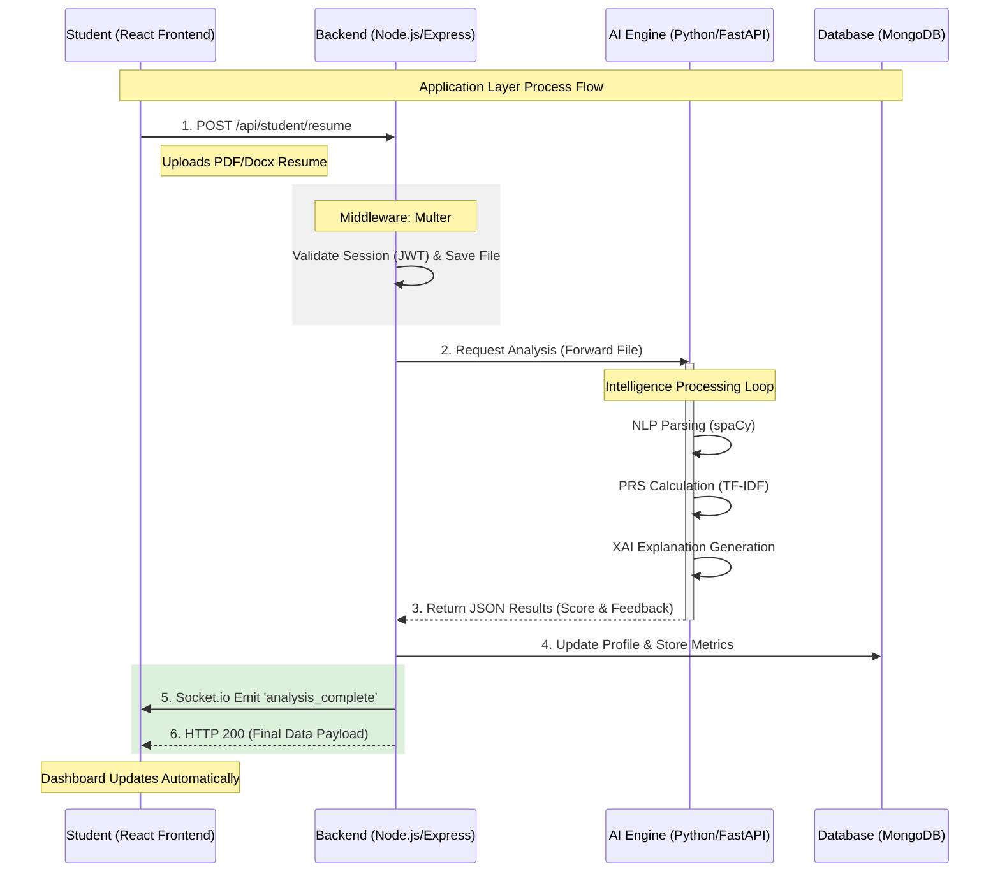

# System Architecture: Application Layer Workflow

This document provides a detailed breakdown of the **Application Layer** within the AI-Powered Campus Placement System. It explains how the system orchestrates communication between the frontend, backend logic, and the AI intelligence tier.

---

## 1. Application Layer Working Diagram

The following sequence diagram illustrates the end-to-end "Working" of the application during a core event: **Resume Analysis**.

---

## 2. Working Explanation

The Application Layer functions as the **Controller** and **Orchestrator** of the entire system. Its working is divided into four main functional responsibilities:

### A. Request Management & Routing
Every action starts at the **API Gateway** (Node.js). When a student or recruiter interacts with the UI (Application Layer Frontend), the Node.js server routes that request to the appropriate **Controller**. 
*   **Work**: It validates that the user is logged in (using JWT) and that they have the right permissions to perform the action.

### B. Business Logic Execution
This is where the "heavy lifting" of the application logic happens. 
*   **Work**: For a placement portal, this involves managing job applications, tracking student progress, and handling the storage of uploaded files. It uses **Multer** to process binary data (like resumes) and prepare them for the AI engine.

### C. Intelligence Interfacing (The AI Bridge)
The Application Layer doesn't perform AI calculations itself; instead, it acts as a bridge.
*   **Work**: It makes an internal API call to the **Python AI Engine**. It sends the raw resume data and receives back a structured JSON response containing the **Professional Ranking Score (PRS)**, extracted skills, and AI explanations.

### D. Real-Time Data Synchronization
Because AI analysis and cognitive games require instant updates, the application layer manages data flow in real-time.
*   **Work**: 
    - **Mongoose**: Consistently saves results into the **MongoDB** database.
    - **Socket.io**: Pushes a "hidden" notification to the student's browser the moment the AI finishes, allowing the dashboard to update without the user needing to refresh the page.

---

## 3. Why this Layer is Critical
Without this layer, the AI Engine (Intelligence) and the React UI (Presentation) would not be able to "talk" to each other. The Application Layer ensures that data is **securely transferred**, **accurately stored**, and **delivered to the user in real-time**.
